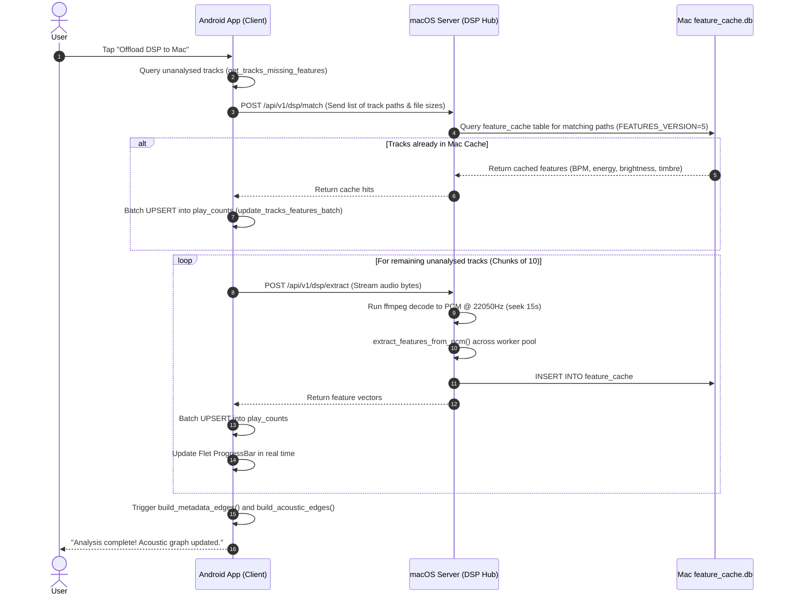
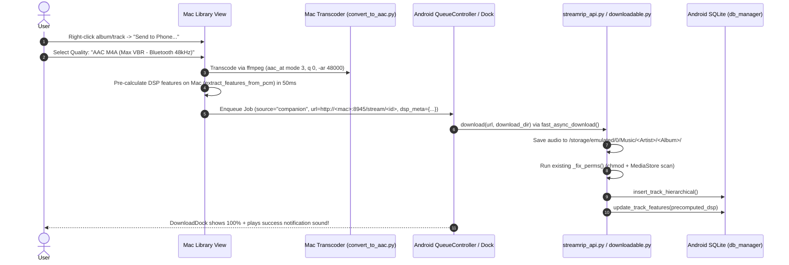

# Mai-An Lab: Device-to-Device Sync & DSP Offloading Architecture
**Document Version:** 1.0.0  
**Target Platforms:** macOS (Desktop Host) & Android (Mobile Client)  
**Codebase Base:** `StreamripApp/` + `tools/`

---

## 1. Executive Summary & Objective

Currently, running Digital Signal Processing (DSP) feature extraction on an Android phone takes ~3–6 seconds per track via hardware decoders and NumPy. On a 5,000-track library, this amounts to over 5 hours of compute that drains battery and heats the device. Conversely, a modern Apple Silicon Mac completes the exact same analysis in tens of milliseconds per track using multi-core `ffmpeg` and parallel process workers.

To solve this, developers previously authored CLI scripts:
* `tools/dsp_offload.py`: Runs host-side feature extraction against an exported state zip bundle.
* `tools/auto_offload.sh`: Automates pulling the zip over ADB, running `dsp_offload.py`, and pushing the analysed bundle back.
* `tools/convert_to_aac.py`: Transcodes high-res/lossless audio into 48 kHz AAC/M4A to overcome Bluetooth audio transmission bottlenecks on mobile.

**The Objective:** Replace the manual ADB cable / terminal workflow with a native, wireless UI feature in both Flet apps. This allows:
1. **1-Click Wireless DSP Offloading:** Android sends unanalysed tracks to macOS; macOS computes or retrieves cached features and updates the phone's database in real time.
2. **Push Songs with Pre-computed DSP:** Mac pushes songs directly to the phone with selectable audio quality (e.g., Bluetooth-optimized M4A) and pre-baked acoustic features so tracks arrive immediately ready for Auto-Play similarity walks.
3. **Full State Bundle Preservation:** Retain the `.zip` snapshot format (`StreamripApp/utils/state_export.py`) as an archival fallback and whole-library migration tool.

---

## 2. Technical & Legal Evaluation of Core Questions

### 2.1. Discovery & Lifecycle: Manual Opt-In Server & User-Initiated Check
* **Manual Server Control on macOS (Zero Penalty for Pure Listeners):**
  * The macOS Companion Server is **OFF by default**.
  * When OFF: Zero sockets are bound, zero ports are open, zero background CPU is consumed, and zero UDP packets are broadcast. Users who simply want to listen to music on their Mac face zero network/battery penalty.
  * **How It Turns ON:**
    1. **Manual Toggle:** A clean switch in Settings $\to$ Companion & Sync: `[ Toggle: Companion Server (On / Off) ]`.
    2. **Context Trigger:** Initiating "Send to Phone..." in the Library view prompts: *"Companion Server is currently offline. Start server for this transfer? [Start & Send]"*.
    3. **Auto-Sleep Timer:** After 15 minutes without real use, the server automatically shuts down to prevent leaving an open port running indefinitely. Heartbeats and transfer polls (`/ping`, `/transfers/pending`) are not use, or a phone in range would keep it up forever. Waiting transfers don't hold it open either: they are persisted and offered again once the server is back on. See §5.1a.
* **The Reality on Android:** Android's Doze Mode and background execution limits (introduced in Android 8.0+ and tightened through Android 14+) aggressively throttle background CPU, suspend network sockets, and sleep Wi-Fi radios when an app is in the background or the screen is off. Running a background daemon on Android to constantly listen for a Mac drains battery and risks OS process termination.
* **The Solution (User-Initiated / View-Initiated Check on Android):**
  * On Android: When the user opens the "Companion & Sync" page in Settings (or pulls down to refresh), Android starts a 10-second UDP listener on port `54545`. Simultaneously, Android attempts a direct HTTP `GET /api/v1/ping` to the **last known Mac IP address** cached in settings.
  * **Result:** Instant connection in under 500 ms when the Mac server is enabled, with zero background battery drain on mobile.

### 2.2. Overcoming Firewalls, Ping Restrictions & Network Isolation

| Network Environment | Challenge | Technical Solution |
| :--- | :--- | :--- |
| **Standard Home WLAN (Same Subnet)** | Simple router firewall, macOS Application Firewall prompt. | • **Never use ICMP `ping`:** Many consumer routers and macOS drop ICMP packets by default. Always use HTTP TCP handshake (`GET /api/v1/ping` with a 1.5s timeout).<br>• The user grants the standard one-time macOS firewall permission prompt for Python/Flet on first launch. |
| **Restricted WLAN (Client / AP Isolation)** *(Coffee shops, hotels, dorms, guest Wi-Fi)* | The router drops all L2/L3 packets between Wi-Fi clients. Even if Mac is `192.168.1.10` and Android is `192.168.1.11`, direct packets are dropped. | **Multi-tier Fallback Strategy:**<br>1. **Personal Hotspot (Zero Router Restriction):** The user enables mobile hotspot on Android, and Mac joins (or vice versa). Client isolation does not exist on personal hotspots.<br>2. **USB Cable (ADB Reverse Tunneling):** If Wi-Fi is impossible, connecting via USB and pressing "Connect via USB" issues `adb reverse tcp:8945 tcp:8945`. Android connects to `http://127.0.0.1:8945` over the cable with zero network configuration.<br>3. **Manual IP / Port / QR Code:** Allows manual entry when UDP broadcast is filtered. |
| **Cellular / Separate Networks** | Devices are behind Carrier-Grade NAT (CGNAT). | Optional Tailscale / WireGuard overlay: If both devices run Tailscale, they share a private `100.x.y.z` encrypted subnet that punches through any NAT automatically. |

### 2.3. Is Peer-to-Peer (P2P) Legal?
* **Legal Evaluation:** **Yes, 100% legal.**
  * Peer-to-peer is a fundamental computer networking architecture (RFC 5694, WebRTC, BitTorrent, Syncthing, AirDrop, Nearby Share, Wi-Fi Direct).
  * In *MGM Studios, Inc. v. Grokster, Ltd.*, 545 U.S. 913 (2005), the U.S. Supreme Court affirmed that technologies capable of substantial non-infringing uses are legal; liability only attaches to intentional third-party copyright infringement inducement.
  * **Private Device Synchronization:** Syncing audio files between a user's own computer and mobile phone for personal, private listening falls squarely within format shifting and private copying doctrines (e.g., U.S. Audio Home Recording Act / Fair Use, and EU private copying levy frameworks). No public swarm, no DHT, and no third-party distribution exists.

### 2.4. Why Not WebRTC / `aiortc` Inside the Android App?
* While WebRTC data channels offer excellent NAT traversal, **`aiortc` cannot be reliably packaged into the Android Python environment** (`serious_python` / Chaquopy). `aiortc` depends on `PyAV`, `libavformat`, and native OpenSSL C-extensions that fail to compile as pure Python wheels for Android ARM64.
* In contrast, **pure async HTTP (`aiohttp`) and UDP sockets (`socket.AF_INET`)** are already compiled, installed in `StreamripApp/requirements.txt`, and run natively on both macOS and Android without adding any external binary dependencies.

### 2.5. Critical Real-World Nuances & Safeguards

| Nuance / Risk | Failure Mode | Mitigation in Architecture |
| :--- | :--- | :--- |
| **1. Port Collisions (Port 8989)** | Port `8989` is the well-known default for Sonarr and other media servers; binding crashes with `OSError: [Errno 48] Address already in use`. | Default to **Port `8945`** with auto-probing fallback (`8945–8949`). The actual bound port is included in the UDP beacon broadcast. |
| **2. Security on Shared / Open Wi-Fi** | Anyone on the same Wi-Fi could query library endpoints or trigger offloads on an active Mac server. | **4-Digit Pairing PIN & Token Auth:** The first time an Android device connects, the Mac UI displays a 4-digit PIN. Android enters it once; both exchange and persist a 256-bit Pre-Shared Key (`Authorization: Bearer <token>`). Unauthenticated requests are rejected (401 Unauthorized). |
| **3. Filepath & Operating System Divergence** | Mac paths (`/Users/chris/Music/...flac`) do NOT exist on Android (`/storage/emulated/0/Music/...m4a`). In `play_counts`, `track_path` is the PRIMARY KEY. Naively porting Mac paths breaks phone lookups. | **Atomic Self-Contained Transfer Manifest:** Transfers include audio + normalized metadata + DSP features. Android generates its own local destination path, inserts into `tracks(path=dest_path)` and `play_counts(track_path=dest_path)`. |
| **4. Unicode Normalization (NFC vs NFD)** | macOS (APFS/HFS+) stores filenames in NFD (decomposed characters, e.g. `e` + combining diaeresis), whereas Android/Linux uses NFC (composed `ö`). In SQLite, raw string equality `WHERE track_path = ?` fails on NFD vs NFC mismatches! | Enforce `unicodedata.normalize('NFC', path)` across all path generation, database insertions, and cache queries on both platforms. |
| **5. Cross-Platform Cache Hits (Metadata Signature)** | When Android offloads an unanalysed track, Mac cannot match it in `feature_cache.db` by path because phone and laptop paths differ. | **Dual-Key Cache Matching:** Mac checks exact path first, then checks canonical metadata signature: `artist.lower() + ':::' + title.lower() + ':::' + round(duration)`. If matched, Mac returns features remapped to the Android track's path! |
| **6. Incomplete Audio on Network Interruption** | Walking out of Wi-Fi range mid-album leaves broken, unplayable audio files that cause decoder crashes. | **Atomic Streaming:** Audio streams to `<filename>.part`. Only after the entire stream is received, verified against the Content-Length header, and tag-verified is it atomically renamed to `.m4a` via `os.replace()`. |
| **7. macOS App Nap & Sleep During Long Offloads** | macOS sleeps the display and CPU if the user walks away during a 500-track offload, stalling the transfer. | Hold an OS sleep-prevention assertion (`caffeinate -i` subprocess tied to the active job lifecycle) on macOS during active processing, auto-released upon completion or server shutdown. |
| **8. Live UI State Invalidation on Android** | Songs arrive in SQLite, but the Library view continues showing stale unanalysed track counters until the user restarts the app. | Grounded in [`StreamripApp/ui/views/library.py:4571`](file:///Users/chrismitsacopoulos/Desktop/Mai-An-Lab/StreamripApp/ui/views/library.py#L4571): when the sync client commits features or new tracks, it sets `self.app.library_view._cached_unanalysed = None` and triggers `self.app.library_view.page.run_task(self.app.library_view.load_library)`. |

---

## 3. Preservation of State Zip Bundles (`mai_an_lab_state_*.zip`)

The user explicitly requested that state zip files be preserved. The existing bundle system in [`StreamripApp/utils/state_export.py`](file:///Users/chrismitsacopoulos/Desktop/Mai-An-Lab/StreamripApp/utils/state_export.py) is battle-tested:
* **Bundle Layout (Version 3, line 27):**
  * `library.db`: SQLite database snapshotted via SQLite Online Backup API (`_snapshot_sqlite`, lines 57–81) avoiding WAL locks.
  * `config.toml`: App configuration and API tokens.
  * `recent_searches.json`: Search history.
  * `manifest.json`: Bundle version and payload file sizes.
* **Stale Journal Cleanup (lines 262–271):** Deletes stale `-wal` and `-shm` journals during import to prevent SQLite corruption.

### Dual-Mode Synchronization Strategy:
1. **Incremental Live Sync (Default):** Used for single track pushes, individual album syncs, and on-the-fly DSP feature calculation. Inserts rows directly into the live database via `db_manager` without restarting the app.
2. **Full State Bundle Sync (Backup & Restore):** Exposed in the UI as **"Wireless Backup & Restore"**:
   * Android calls `state_export.export_state()` locally, then streams the resulting `.zip` to Mac over HTTP (`POST /api/v1/bundle/upload`).
   * Mac stores the bundle in `tools/state_backups/` and can run `dsp_offload.py` on it, returning the `.analysed.zip` wirelessly.
   * Completely eliminates the need to run `adb pull` and `adb push` manually.

---

## 4. End-to-End Workflows & Code Evidence

### 4.1. Workflow 1: Wireless DSP Offloading (Phone $\to$ Mac $\to$ Phone)



#### Code Evidence in Existing Codebase:
1. **Missing Tracks Query:** [`StreamripApp/utils/db_manager.py`](file:///Users/chrismitsacopoulos/Desktop/Mai-An-Lab/StreamripApp/utils/db_manager.py#L1491-L1530)
   ```sql
   SELECT t.path FROM tracks t
   LEFT JOIN play_counts pc ON pc.track_path = t.path
   WHERE pc.timbre IS NULL OR COALESCE(pc.features_version, 0) < ?
   ```
2. **Mac Host Computation:** Reuses [`StreamripApp/utils/dsp.py`](file:///Users/chrismitsacopoulos/Desktop/Mai-An-Lab/StreamripApp/utils/dsp.py#L812-L875):
   * Function `extract_features_from_pcm(pcm_path, sr)` computes RMS energy, spectral centroid, rolloff, flatness, contrast, chroma, key index, onset envelope BPM, rhythm, and MFCC mean/std.
   * Preserves `_relocate_moov_to_front()` from [`tools/dsp_offload.py`](file:///Users/chrismitsacopoulos/Desktop/Mai-An-Lab/tools/dsp_offload.py#L180-L240) to decode fragmented MP4s without failure.
3. **Database Injection:** Currently, `update_track_features()` in [`StreamripApp/utils/db_manager.py:1491`](file:///Users/chrismitsacopoulos/Desktop/Mai-An-Lab/StreamripApp/utils/db_manager.py#L1491) updates one track at a time. We introduce `update_tracks_features_batch(updates)` to commit 100 tracks per transaction under one lock.

---

### 4.2. Workflow 2: Sending Songs with Transcoding & Pre-baked DSP (Mac $\to$ Phone)

#### Reusing the Existing Download Machinery for Scoped Storage & UI Parity
Rather than building a bespoke file receiver on Android, **we reuse the app's existing, battle-tested download machinery**!
* **The Download Pipeline:** In [`StreamripApp/utils/streamrip_api.py:214-220`](file:///Users/chrismitsacopoulos/Desktop/Mai-An-Lab/StreamripApp/utils/streamrip_api.py#L214-L220), the app already resolves public storage paths via [`storage_paths.py`](file:///Users/chrismitsacopoulos/Desktop/Mai-An-Lab/StreamripApp/utils/storage_paths.py), enforces non-sandbox paths, and creates directory trees.
* **Android Scoped Storage & MediaStore Fixer:** In [`streamrip_api.py:380-396`](file:///Users/chrismitsacopoulos/Desktop/Mai-An-Lab/StreamripApp/utils/streamrip_api.py#L380-L396), the download pipeline already executes `_fix_perms()`:
  * Applies `os.chmod(dest_path, 0o666)` and parent `0o777`.
  * Triggers Android's Media Scanner broadcast (`android.intent.action.MEDIA_SCANNER_SCAN_FILE`).
  * Inserts the file into Android's external MediaStore Content Provider (`content://media/external/file`).
* **Existing Queue & Dock UI:** In [`StreamripApp/utils/queue_controller.py`](file:///Users/chrismitsacopoulos/Desktop/Mai-An-Lab/StreamripApp/utils/queue_controller.py), the `QueueController` and the bottom `DownloadDock` widget already handle multi-track batch queueing, progress percentage, retries, cancellation, and success audio cues.

#### Ensuring 100% Download UI Compatibility with `source="companion"`
To ensure seamless visual integration in `DownloadDock` without visual glitches or missing styles:
1. **Source Colors:** Add `"companion": "#30D158"` (Apple System Green) to `SOURCE_COLORS` in [`StreamripApp/ui/tokens.py`](file:///Users/chrismitsacopoulos/Desktop/Mai-An-Lab/StreamripApp/ui/tokens.py#L54). This automatically styles the source badge in `download_dock.py:286` with a translucent green container.
2. **Quality Badges:** The job metadata sets `quality_label="AAC VBR"` (or `320K`, `FLAC`), which `download_dock.py:293` displays alongside the `COMPANION` badge.
3. **URL Detection Extension:** Extend `_detect_type_and_id()` in [`StreamripApp/utils/streamrip_api.py:168`](file:///Users/chrismitsacopoulos/Desktop/Mai-An-Lab/StreamripApp/utils/streamrip_api.py#L168) with:
   ```python
   (r'^https?://[^/]+/api/v1/(?P<media_type>track|album)/(?P<id>[^/?#]+)', None, 'companion')
   ```
   Or allow `source="companion"` in `download()` so the stream bypasses Deezer/Qobuz parsers and streams from the Mac server via `fast_async_download`.
4. **DSP Injection Hook:** On job completion in `streamrip_api.py`, if `dsp_metadata` exists in the job, call `db_manager.update_track_features()` directly so the newly saved track arrives with complete acoustic features.

Treating the Mac server as a high-speed local streaming source (`source="companion"`) means incoming tracks pass through the exact same download machinery:



#### Why AAC/M4A Transcoding is Crucial for Bluetooth:
* **The Bluetooth Bottleneck:** Standard Bluetooth codecs (SBC, standard AAC, aptX) operate with bitrates between 256–345 kbps at 44.1 or 48 kHz.
* **AudioToolbox Hardware Acceleration:** In [`tools/convert_to_aac.py`](file:///Users/chrismitsacopoulos/Desktop/Mai-An-Lab/tools/convert_to_aac.py#L73-L85):
  * Encoder `aac_at` uses macOS Apple AudioToolbox.
  * `-aac_at_mode 3 -q:a 0 -aac_at_quality 0` generates true Variable Bitrate (VBR) AAC matching Apple's mastered-for-iTunes quality profile.
  * `-ar 48000` downsamples 96kHz/192kHz high-res files to 48kHz, preventing mobile Bluetooth audio daemon stutter.
  * Embedded artwork and metadata are preserved using `-map 0:a -map 0:v? -c:v copy` (lines 99–120).

---

## 5. Network Protocol Specification

All communications occur via standard HTTP/1.1 REST using JSON and binary octet-streams over a single port (`8945` by default; the next free port up to `8949` if taken).

### 5.1. UDP Discovery (Beacon + Query/Response)
* **Port:** UDP `54545`.
* **Beacon:** the Mac broadcasts every 2 s to `255.255.255.255` and to the real broadcast address of every non-VPN interface, read from `ifconfig` (a `/24` guess is wrong on a `/16` campus network, and `255.255.255.255` alone goes out the default route, which is the tunnel when a VPN is up). The advertised `ip` is the first non-VPN address.
* **Query/response (primary path on Android):** Android drops inbound broadcast datagrams unless the app holds a `WifiManager.MulticastLock`, which needs pyjnius, and pyjnius is not in the serious_python build. So the phone broadcasts a query every 2 s (sending needs no lock), and the Mac answers by **unicast** to the sender, which is always delivered.
* The listener uses the datagram's **source address** as the Mac's IP (the advertised `ip` can name another interface on a multi-homed Mac). It re-reports a known server at most every 10 s.
* The listener runs only while searching: it stops once connected and whenever the app goes to the background.
* **Payloads:**
```json
{"service": "mai_an_sync", "version": 1, "type": "query"}
{"service": "mai_an_sync", "version": 1, "type": "beacon",
 "name": "Chris's MacBook Pro", "ip": "192.168.1.50", "port": 8945}
```
* **macOS:** the app (or the terminal running it) needs Local Network access (System Settings → Privacy & Security → Local Network). If it is denied, sends fail with `EHOSTUNREACH` and nothing else reports it.

### 5.1a. When Discovery Fails: "Find Mac" & Idle Auto-Off
* **Find Mac (phone):** user-triggered, in order: USB tunnel and last known address → a fresh broadcast query (3 s) → a TCP-connect sweep of the phone's `/24` on port 8945 (and the cached port). Its result is shown as a sentence that stays on screen. When connected, the same button becomes **Test Connection** and reports the round-trip time.
* **What each outcome means:**
  * Found by the sweep: the network drops broadcasts but routes unicast. The address is saved, so later probes reach it directly.
  * Manual IP refused: the Mac is reachable, and the server is off or on another port.
  * Manual IP timed out: the network isolates clients (or the Mac is away). Only the hotspot, USB, or an overlay like Tailscale will work.
* **Large networks:** the Mac's Sync Hub warns when its subnet is wider than `/24` (typical of office and campus Wi-Fi, which block discovery and often isolate clients), lists its other addresses, and flags a VPN on the default route.
* **Idle auto-off (phone):** after 15 min without pairing, transfers, offload, backup or a Find Mac tap, the manager stops discovery, probing and heartbeats and shows "Paused". The enabled preference is kept. It wakes on Find Mac, the switch, Manual IP, or the next app launch, but not on app resume. Downloads still in the queue hold it awake, for at most 1 h.

### 5.1b. Authentication & Connection Lifecycle
* **Token:** one 128-bit bearer token per Mac, persisted in prefs (`companion_server_token`) so pairings survive Mac restarts. "Reset Pairing" on the Mac issues a new token and a new PIN.
* **PIN:** 4 digits, rotated after 5 wrong attempts.
* **Loopback trust:** requests from `127.0.0.1` (the `adb reverse` USB tunnel) skip the token, since physical access to the cable is the trust anchor.
* **Download URLs:** these carry the token as `?token=`, because the download pipeline sends plain GETs.
* **Ping is unauthenticated** (discovery needs it) but returns `"authorized": true|false`, so the phone learns immediately whether its token is still valid.
* **Phone connection flow:**
  1. Ping with the saved token.
  2. If authorized, connect. If not, show the PIN prompt. Dismissing it snoozes that Mac for 2 min.
  3. While connected, a heartbeat runs every 15 s. Two misses drop the link; `authorized: false` clears the token and re-prompts for the PIN.
* **Probe order:** `127.0.0.1:8945` (USB) first, then the last LAN host and port.
* **Background:** probing and the heartbeat idle while the app is backgrounded, and everything is re-checked on resume.
* **Singletons:** the manager (`get_sync_manager`) and the server (`get_companion_server`) are one per process, so a UI restart does not spawn a second instance competing for the ports.

### 5.2. HTTP REST Endpoints (Mac Server)

#### `GET /api/v1/ping`
* **Purpose:** Health check, latency probe, and handshake.
* **Response:**
```json
{
  "status": "ok",
  "device": "macOS",
  "app_version": "2.0.0",
  "features_version": 5,
  "total_tracks": 4820,
  "requires_pairing": true,
  "authorized": true
}
```

#### `POST /api/v1/pair`
* Body `{"pin": "1234", "device_name": "Android Phone"}` returns `{"token": ...}`, or 403 for a wrong PIN.

#### Transfers (Mac → Phone)
* `GET /api/v1/transfers/pending` (auth): the queued tracks. Each has `id`, which is stable per (path, quality), so re-sending replaces the entry. It also has `stream_path`, `dsp_features` and the metadata. The queue is persisted to `companion_transfers.json` next to the Mac's prefs, and entries whose files were deleted are dropped on load.
* `GET /api/v1/tracks/stream?path=…&quality=…&token=…`:
  * Serves only paths that are currently queued.
  * Transcodes on demand, with the cache keyed on the full path.
  * The phone builds this URL from its own base URL (so it works over USB) and downloads to a `.part` file. The file is renamed after a size check, and is never written over a different file with the same name.
* `POST /api/v1/transfers/ack` (auth): sent only after the file has landed on the phone. Failed downloads stay queued and are offered again.

#### `POST /api/v1/dsp/match`
* **Purpose:** Differential cache lookup. Android sends track identifiers; Mac returns any features already present in `feature_cache.db`.
* **Request:**
```json
{
  "tracks": [
    {"path": "/storage/emulated/0/Music/Artist/Song1.flac", "title": "Song 1", "artist": "Artist"},
    {"path": "/storage/emulated/0/Music/Artist/Song2.flac", "title": "Song 2", "artist": "Artist"}
  ]
}
```
* **Response:**
```json
{
  "cached": [
    {
      "path": "/storage/emulated/0/Music/Artist/Song1.flac",
      "bpm": 124.0,
      "energy": 0.78,
      "brightness": 0.42,
      "rolloff": 0.55,
      "beat_strength": 0.81,
      "spectral_flatness": 0.12,
      "spectral_contrast": 0.35,
      "key_index": 7,
      "timbre_base64": "..."
    }
  ],
  "missing_paths": ["/storage/emulated/0/Music/Artist/Song2.flac"]
}
```

#### `POST /api/v1/dsp/extract`
* **Purpose:** Extract features from uploaded audio files.
* **Headers:** `Content-Type: multipart/form-data`
* **Payload:** A `path` form field (the phone's path), followed by a `file` part. The path is not sent as a header: header values must be latin-1, and Greek paths are not.
* **Decode window:** skip 15 s, then read `MAX_SECONDS` (120 s), the same window as the on-device analyser and `tools/dsp_offload.py`. A shorter window makes the features drift from the rest of the library.
* **Failure handling:** the client aborts after 3 consecutive network failures. Features computed so far are always committed.
* **Response:** Extracted feature dictionary for each processed track.

#### `POST /api/v1/bundle/upload` & `GET /api/v1/bundle/download`
* **Purpose:** Transfer full `mai_an_lab_state_*.zip` bundles wirelessly.

---

## 6. UI / UX Design in Flet

The UI follows the existing Apple HIG dark palette tokens defined in [`StreamripApp/ui/tokens.py`](file:///Users/chrismitsacopoulos/Desktop/Mai-An-Lab/StreamripApp/ui/tokens.py):
* Background: `BG = "#000000"`
* Cards / Surfaces: `SURFACE = "#1C1C1E"`, `SURFACE2 = "#2C2C2E"`
* Accent: `CYAN = "#FFD60A"` (or user theme accent), `AMBER = "#FF9F0A"`
* Radius: `RADIUS_CARD = 14`, `RADIUS_PILL = 20`

### 6.1. Settings Subpage: "Companion & Sync"
Registered in `_build_search_registry()` in [`StreamripApp/ui/views/settings.py:938`](file:///Users/chrismitsacopoulos/Desktop/Mai-An-Lab/StreamripApp/ui/views/settings.py#L938) under category `SYNC & ECOSYSTEM`:

```
┌────────────────────────────────────────────────────────────────┐
│  ← Companion & Sync                                            │
├────────────────────────────────────────────────────────────────┤
│  CONNECTION STATUS                                             │
│  ┌──────────────────────────────────────────────────────────┐  │
│  │  🟢  Chris's MacBook Pro (192.168.1.50:8945)              │  │
│  │      Round-trip latency: 3 ms • DSP Hub Ready            │  │
│  │                                                          │  │
│  │  [ Disconnect ]          [ Scan Again ]                  │  │
│  └──────────────────────────────────────────────────────────┘  │
│                                                                │
│  DSP FEATURE OFFLOADING                                        │
│  ┌──────────────────────────────────────────────────────────┐  │
│  │  📊 428 unanalysed tracks in local phone library         │  │
│  │     On-phone estimate: ~35 min (battery intensive)       │  │
│  │     Mac offload estimate: ~18 sec (multi-threaded)       │  │
│  │                                                          │  │
│  │  [⚡ Offload to Mac]            [Rebuild Graph & PCA]    │  │
│  │                                                          │  │
│  │  Progress: [██████████████████░░░░░░░░░░░] 64% (274/428)  │  │
│  │  Rate: 32 tracks/s • ETA: 5s • Ingesting into play_counts│  │
│  └──────────────────────────────────────────────────────────┘  │
│                                                                │
│  STATE BUNDLE ARCHIVES (ZIP)                                   │
│  ┌──────────────────────────────────────────────────────────┐  │
│  │  📦 Full Database & State Backup                         │  │
│  │     Keep timestamped .zip bundles for fallback safety    │  │
│  │                                                          │  │
│  │  [ Send State to Mac ]       [ Pull State from Mac ]     │  │
│  └──────────────────────────────────────────────────────────┘  │
└────────────────────────────────────────────────────────────────┘
```

### 6.2. Multi-Select UX & 1-Click Collection Pushes
Long-pressing track-by-track for multiple songs is tedious. The architecture provides **three distinct interaction levels** for batch selection:

#### Level 1: 1-Click Collection Pushes (Albums & Playlists)
* In [`StreamripApp/ui/views/library.py`](file:///Users/chrismitsacopoulos/Desktop/Mai-An-Lab/StreamripApp/ui/views/library.py), albums and playlists represent the natural unit of music listening.
* **Album Context Menu:** Long-pressing an album row (or clicking its context menu) includes **"📱 Send Entire Album to Phone..."** which gathers all track paths in that album and opens the batch transfer modal.
* **Playlist Header Action:** When viewing a playlist, an action button **"📱 Send Playlist to Phone"** queues all playlist tracks at once.

#### Level 2: Library Multi-Select Mode
* In `_open_track_context_menu()` ([`library.py:4140`](file:///Users/chrismitsacopoulos/Desktop/Mai-An-Lab/StreamripApp/ui/views/library.py#L4140)), long-pressing any track offers a new action: **"☑️ Select Multiple..."**.
* **Selection State:**
  * Library enters `selection_mode = True`.
  * Track rows render leading checkboxes. Tapping any row toggles its selection.
  * A persistent Bottom Selection Dock appears above the player dock:
    ```
    ┌─────────────────────────────────────────────────────────────────┐
    │  ✕ Cancel   ·   18 tracks selected (~162 MB)   ·   [ 📱 Send (18) ]│
    └─────────────────────────────────────────────────────────────────┘
    ```
  * Tapping **Send** opens the quality selection modal and transfers all 18 tracks in a single queue.

#### Level 3: Desktop Bulk Sync Manager in Settings
* In `Settings → Companion & Sync` on macOS, a dedicated **"Sync Collections to Phone"** panel allows the user to browse their entire library by:
  * **[ Albums ]** (Checkboxes for full albums)
  * **[ Artists ]** (Checkboxes to select all albums by an artist)
  * **[ Playlists ]** (Checkboxes for curated playlists)
* Displays a live transfer appraisal: *"4 Albums, 1 Playlist selected (62 tracks, ~580 MB)"*.
* A single click pushes all 62 tracks, complete with on-the-fly AAC transcoding and pre-computed DSP feature injection.

---

### 6.3. SQL Robustness, Filepath Divergence & Unicode Encoding

#### The Filepath Divergence Problem
* **Mac Paths:** `/Users/chris/Music/Daft Punk/Discovery/01 One More Time.flac`
* **Android Paths:** `/storage/emulated/0/Music/Daft Punk/Discovery/01. One More Time.m4a`
* In `play_counts`, the schema is `track_path TEXT PRIMARY KEY`. In `tracks`, `path TEXT UNIQUE NOT NULL`.
* **The Danger:** If Mac pushes database records with Mac paths, Android's local SQLite database will reference non-existent files, breaking Auto-Play similarity lookups.

#### The Robust Resolution:
1. **Self-Contained Transfer Manifest:** The Mac streams the audio and serializes an atomic manifest containing:
   * Metadata: `title`, `artist`, `album`, `year`, `genre`, `genre_bucket`, `track_num`, `duration`, `bitrate`, `format`.
   * Pre-computed DSP: `bpm`, `energy`, `brightness`, `rolloff`, `beat_strength`, `spectral_flatness`, `spectral_contrast`, `key_index`, `timbre_blob`, `features_version`.
2. **Canonical Local Path Generation on Android:**
   * Android uses its own [`storage_paths.py`](file:///Users/chrismitsacopoulos/Desktop/Mai-An-Lab/StreamripApp/utils/storage_paths.py) to resolve its destination directory (`/storage/emulated/0/Music/Artist/Album/`).
   * Generates its own local path: `dest_path = os.path.join(album_dir, f"{track_num:02d}. {clean_filename(title)}.{extension}")`.
3. **Universal Unicode NFC Canonicalization:**
   * macOS APFS/HFS+ decomposes Unicode filenames (NFD, e.g. `e` + combining acute `\u0301`).
   * Android / Linux / FAT32 uses composed Unicode (NFC, e.g. `é` `\u00e9`).
   * In SQLite, string comparisons and `PRIMARY KEY` lookups (`WHERE track_path = ?`) are byte-for-byte exact matches. An NFD/NFC discrepancy causes silent lookup failures!
   * **Enforcement:** All paths written to or queried from SQLite are strictly normalized:
     ```python
     dest_path = unicodedata.normalize("NFC", raw_dest_path)
     ```
4. **Dual-Key Matching for Reverse DSP Offload:**
   * When Android offloads an unanalysed track, Mac checks its `feature_cache.db` using a **Composite Metadata Signature**:
     ```python
     canonical_key = f"{clean_filename(artist).lower()}:::{clean_filename(title).lower()}:::{int(round(duration))}"
     ```
   * If a match exists (even from an earlier FLAC ripped on Mac), Mac returns the pre-computed DSP features **remapped to the Android track's path**!
   * Phone ingests the features into its own SQLite without re-decoding.

---

### 6.4. Mac Library Context Action: "Send to Phone..."
In [`StreamripApp/ui/views/library.py`](file:///Users/chrismitsacopoulos/Desktop/Mai-An-Lab/StreamripApp/ui/views/library.py), right-clicking any track or album provides:
* **Modal Dialog:**
  1. **Destination:** `[ Chris's Phone (192.168.1.120) ▼ ]`
  2. **Transcode Quality:**
     * `AAC M4A - Maximum VBR (AudioToolbox q:0, 48kHz) [Recommended for Bluetooth]`
     * `AAC M4A - 320 kbps CBR (High Bitrate)`
     * `AAC M4A - 256 kbps CBR (Balanced)`
     * `Original (FLAC / MP3 / M4A as-is)`
  3. **Acoustic Pre-computation:** `[x] Calculate DSP features on Mac before sending` (Default: Checked).
  4. **Action:** `[ Transfer Selected Tracks (~72 MB) ]`

---

## 7. Implementation Roadmap & Modular Architecture

### New Directory Structure
```
StreamripApp/
└── utils/
    └── sync/
        ├── __init__.py
        ├── discovery.py      # UDP broadcast beacon & listener
        ├── server.py         # aiohttp.web server (Mac host)
        ├── client.py         # aiohttp client (Android requester)
        └── transcoder.py     # ffmpeg AAC transcode & DSP bundling
```

### Step-by-Step Milestones
1. **Milestone 1 (Database Batching):** Add `update_tracks_features_batch(updates)` to `StreamripApp/utils/db_manager.py` to support high-throughput SQLite inserts without WAL locking.
2. **Milestone 2 (Networking Engine):** Implement `discovery.py`, `server.py`, and `client.py` using `aiohttp`.
3. **Milestone 3 (Transcoder Service):** Port `tools/convert_to_aac.py` into `utils/sync/transcoder.py`, integrating `extract_features_from_pcm` so transfers include pre-baked features.
4. **Milestone 4 (Flet UI):** Build `StreamripApp/ui/views/sync_hub.py`, add search registry entry in `settings.py`, and wire context menu items in `library.py`.
5. **Milestone 5 (Verification):** Test with 100+ tracks over local Wi-Fi, verify Bluetooth playback quality on Android, and verify graph/PCA rebuild.

